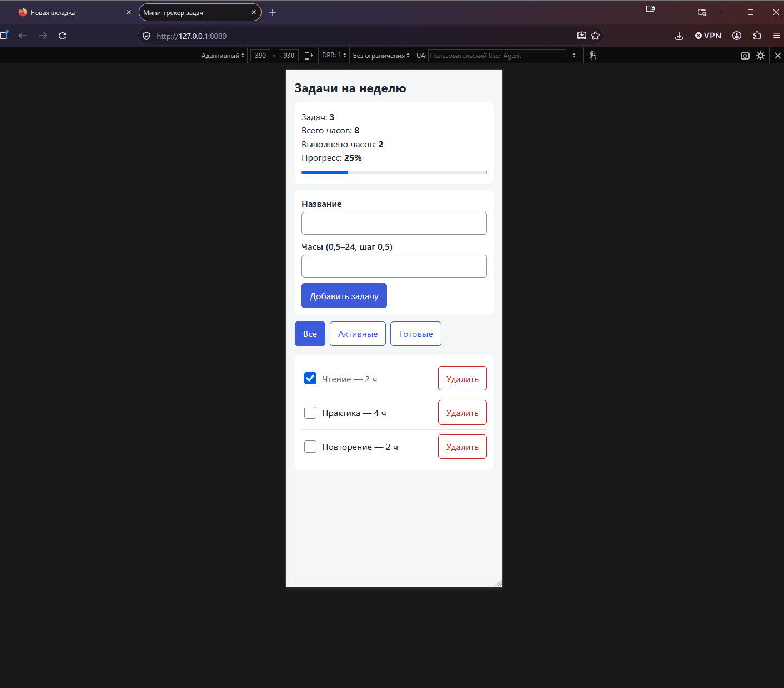
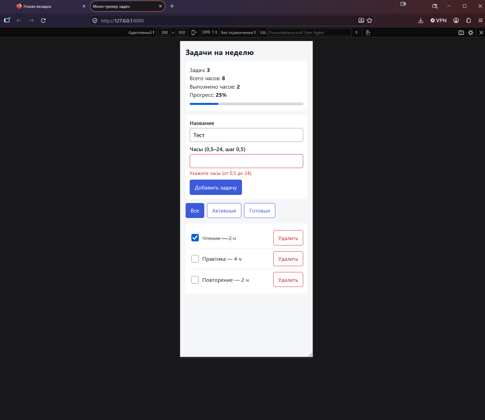
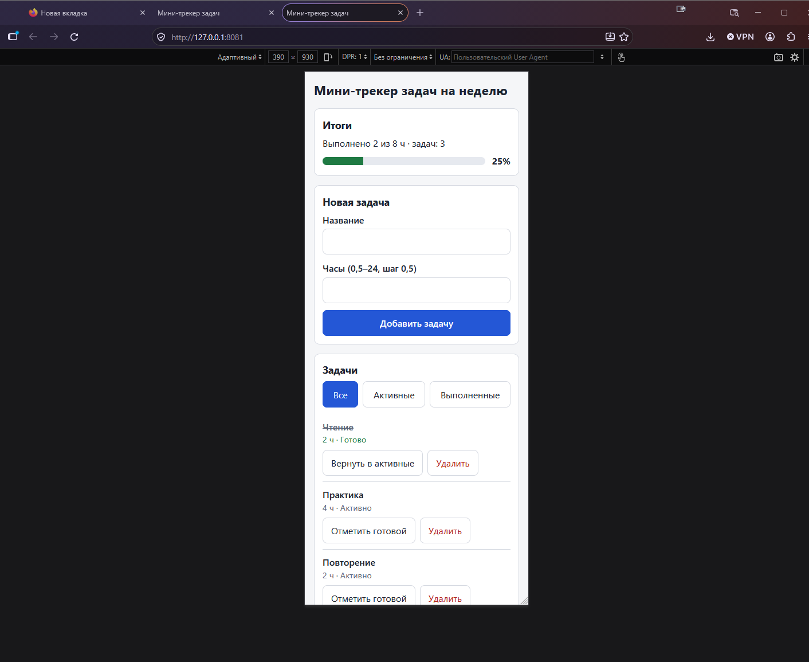
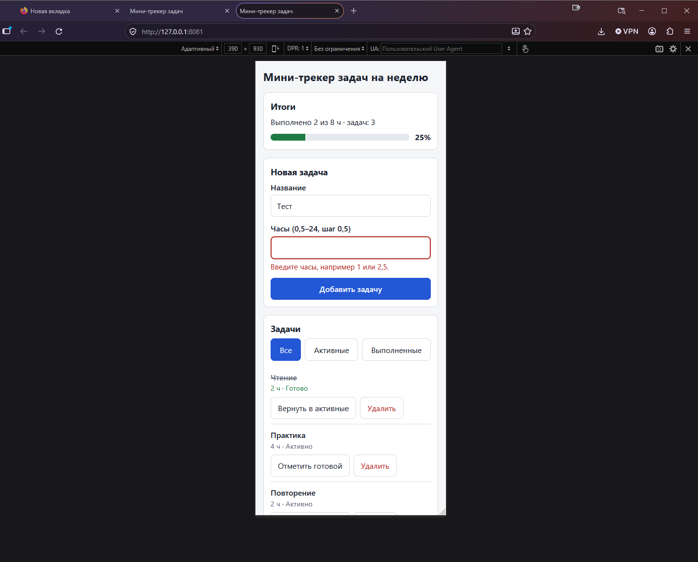

# ДЗ1 · вариант B: мини-трекер, direct и with-spec

Один и тот же мини-трекер реализован дважды одной моделью:

- `direct/` — прямое задание по `brief.md`, без OpenSpec.
- `with-spec/` — сначала спецификация OpenSpec (`openspec/changes/build-tracker/`), затем реализация по ней.

`shared/brief.md` — исходная постановка и проверки T1–T5. Копии в обеих папках совпадают.
Отчёт: [REPORT.md](REPORT.md). Журналы обращений и логи команд: [logs/](logs/).

Модель: Claude Sonnet 5.5 (claude-sonnet-5-5) · Ассистент: Claude Code · OpenSpec 1.14.1 · Node.js 24.22.3

## Запуск

В папке `direct/` или `with-spec/`:

```
node --test tests/acceptance.test.mjs
node --check app.mjs
node --check domain.mjs
npx --yes http-server@14.1.1 . -p 8080 -c-1
```

Откройте http://127.0.0.1:8080. Для второй папки используйте `-p 8081`.

В Windows PowerShell с запретом скриптов вместо `npx` и `openspec` вызывайте `npx.cmd` и `openspec.cmd`. Двойной клик по `index.html` (`file://`) не подойдёт: браузер блокирует ES-модули.

Проверка спецификации (в `with-spec/`):

```
openspec validate build-tracker --strict --no-interactive
```

## Промпты

Полные тексты всех сообщений обеим сессиям — в [logs/journal-direct.md](logs/journal-direct.md) и [logs/journal-with-spec.md](logs/journal-with-spec.md), основные — в [REPORT.md](REPORT.md#промпты).

## Скриншоты (Firefox, 390 px)

| | T1: исходный пример | T4: пустые часы |
|---|---|---|
| direct |  |  |
| with-spec |  |  |

## Структура

```
shared/brief.md          постановка и T1–T5
direct/                  попытка 1: код, тесты, REPORT.md ассистента
with-spec/               попытка 2: openspec/changes/build-tracker/, код, тесты, README.md
logs/                    журналы обращений и реальные логи команд
screenshots/             скриншоты ручной проверки
REPORT.md                общий отчёт
```
